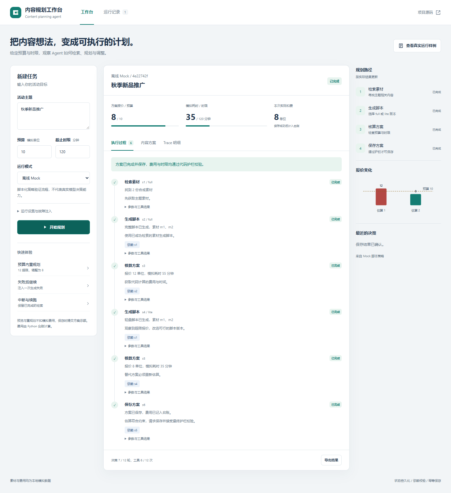

# 内容任务规划 Agent

Python 3.10+ 的原生 ReAct 作业项目。运营人员输入主题、模拟预算和模拟分钟数，Agent 使用本地素材检索、脚本生成、报价和保存工具，返回状态、依赖、历史结果、费用台账和可追溯的保存产物。

**Mock 只验证流程，不证明真实模型决策效果。** 本仓库另外保留实际调用 DeepSeek `deepseek-v4-pro` 的记录；真实运行与 Mock 分目录、分 backend 标记。没有把脚本策略冒充真实模型。

## 可视化工作台

运行 `python -m src.web`，打开 [http://127.0.0.1:8765](http://127.0.0.1:8765)。

页面支持任务配置、Mock/真实模型模式、执行步骤、报价变化、方案查看、Trace 下载、故障注入、历史记录与断点续跑。直接调用原有 Python Agent，不需要 npm；真实模式沿用下方环境变量配置，密钥不进入浏览器。

[前端使用与接口说明](docs/06-web-workbench.md) · [浏览器实际验收](examples/web-ui-results.json)



## 快速运行

安装 Python 3.10+，在项目根目录执行：

```bash
python -m venv .venv
# Windows PowerShell: .venv\Scripts\Activate.ps1
# macOS/Linux: source .venv/bin/activate
python -m pip install -r requirements.txt
```

三条运行命令（第二条先设置下面的环境变量，第三条替换为实际 run_id）：

```bash
python -m src.cli --topic "秋季新品推广" --budget 10 --deadline 120 --mock-llm
python -m src.cli --topic "秋季新品推广" --budget 10 --deadline 120
python -m src.cli --resume <run_id>
```

成功返回码 0；needs_input/incomplete 返回码 2。CLI stdout 是完整 JSON；状态写入 `runs/<run_id>.json`，本地保存方案位于 `saved_plans/`，运行证据默认导出 `examples/<run_id>/`。

真实模型设置（PowerShell）：

```powershell
$env:LLM_BASE_URL = "https://api.deepseek.com"
$env:LLM_MODEL = "deepseek-v4-pro"
$env:LLM_API_KEY = Read-Host "输入 API Key"
```

Bash 使用 `export LLM_BASE_URL=...` 等设置。程序读取进程环境变量；**不自动加载 .env 文件**，`.env.example` 只是字段模板。API Key 不进入状态、Trace 或文档。真实服务可能产生实际 API 账单；这不属于业务的模拟预算。

本次只读查询服务模型列表后确认了 `deepseek-v4-pro`，没有假设“pro”就是 API 模型 ID。兼容后端需支持 `/chat/completions`、JSON response_format 和 messages；base URL 如有 `/v1` 必须自行包含该前缀。

## 测试与复现

```bash
python -m pytest -q
python -m scripts.run_examples
python -m scripts.audit_examples
```

`run_examples` 用新隔离保存目录执行 15 个场景，并实际运行 pytest，把输出写入 `examples/pytest-results.txt`。它会重新生成编号 01–15 的示例，不覆盖真实模型记录。审计脚本读取现有产物，核对 Trace、预算、失败状态及台账，输出 SHA-256 摘要。

故障与续跑：

```bash
python -m src.cli --topic "秋季新品推广" --budget 10 --deadline 120 --mock-llm --inject-failure generate_script:1 --max-steps 2
python -m src.cli --resume <上条输出的run_id> --max-steps 12
```

`--inject-failure TOOL:N` 使该工具前 N 次实际调用失败，可重复指定不同工具。校验拒绝不消耗注入次数。注入剩余次数持久化；恢复时不重新注入已消费的失败。

`--max-steps` 和 `--max-tool-calls` 默认均为 12，必须为正整数。达到任一上限均返回 `incomplete/max_steps_reached`，Trace 的 limit 字段区分来源。恢复后的上限是**整个 run 的累计上限**，不是新增步数；已耗尽时需要显式提高。恢复使用原来的 backend，真实模型仍需环境变量。使用自定义 runs/saved 路径时，续跑也要传相同路径。不支持多个进程同时恢复同一 run。

缺 budget 或 deadline 会直接 needs_input，不初始化网络客户端、不调用工具。补齐字段后新建请求；不能通过 resume 偷改原请求。

## 如何理解预算

模拟单位均为整数，预算和时间限制允许有限非负数。deadline 表示方案执行的模拟分钟数，不是 API 延迟或墙钟时间。

| 执行组件 | full 费用/分钟 | lite 费用/分钟 |
|---|---:|---:|
| 素材检索 | 2 / 10 | 1 / 5 |
| 脚本制作 | 8 / 40 | 4 / 20 |
| 本地保存/交付 | 2 / 5 | 1 / 3 |

估算器是免费的核算工具，两个标签均为 0 / 0，不属于收费执行组件。搜索和生成工具返回的是**方案组件报价**：预览、重规划和注入失败本身不扣模拟费用，保存时一次提交所选方案的组件总额。这个计费口径是实现“12 → 8”的明确前提；如果检索与生成每次都实际收费，废弃 full 方案的支出不能消失，预算 10 的参考路径将不成立。

- 初始 full：2 + 8 + 2 = **12**，55 分钟。
- 保留 full 检索，lite 脚本，full 保存：2 + 4 + 2 = **8**，35 分钟。
- 全 lite 最低报价 **6**，28 分钟；预算 5 时缺口为 1。
- `total_cost/total_minutes` 是当前已估算/已保存方案总额；`charged_cost` 是本次 run 台账的实际模拟扣费。
- 重复请求仍显示方案费用 8，但第二个 run 扣费 0。旧报价保存在成功步骤中，不从历史删除，也不会误加进扣费。
- 每次保存重新核价、核验依赖及两项上限。保存后锁定该 run，只能结束，避免多次提交累计超过预算。

幂等键是主题、规范化后的预算/时限及所选方案内容的 SHA-256。保存对象中不包含随机步骤 ID，因此重复执行相同内容得到同一文件。不同所选内容可形成不同方案，这是内容级幂等的边界。

## 证据导航

- [完整验收对照](docs/03-evaluation.md)
- [实际 pytest 输出](examples/pytest-results.txt)
- [Mock 超预算重规划](examples/07-budget-replan/trace.jsonl)
- [Mock 失败与恢复](examples/06-resume-after/trace.jsonl)
- [真实 Pro 观察 12 后改为 8](examples/18-real-observed-replan/trace.jsonl)
- [真实 Pro 注入失败后调整](examples/19-real-failure-final/trace.jsonl)
- [状态与技术设计](docs/02-solution.md)

真实模型的早期预算运行直接选择 lite，没有经历超限。该记录保留在 16 目录；目录名不能代替 Trace 事实。随后将“先评估 full 作为质量基线”明确写成模型规划偏好，18 目录实际产生了 12 → 8。执行器没有写死下一步动作，也没有替模型选择重试。

## 项目结构与依赖

`src/`：agent 执行骨架、llm 两种后端、tools 本地工具、state 持久化、guardrails 代码护栏、trace 导出及 cli。
`tests/`：工具、状态、CLI、异常动作、幂等与中断恢复测试。
`frontend/`：原生交互页面，由 `src/web.py` 提供同源 API。

`data/`：合成素材与报价表。
`scripts/`：实际示例生成及证据审计。
`docs/`：需求、方案、验收、AI 使用和复盘。
`examples/`：可提交的实际运行记录和保存文件副本。

运行时仅使用 Python 标准库（urllib、json、dataclasses、pathlib 等），没有大型 Agent 框架。唯一直接测试依赖为 **pytest 8.3.5**。GitHub Actions 配置了 Ubuntu/Windows 与 Python 3.10/3.12 测试矩阵；本地实际测试环境是 Windows/Python 3.12，首次发布的远端 CI 已在这四种环境全部通过，后续提交状态以 GitHub Actions 为准。

## 限制与提交

本地 Mock 工具生成模板脚本，并非生产文案服务；没有真实发布、检索引擎、生产级 Runtime 或 LLM 质量评分。Mock 的策略分支只是离线测试替身。真实模型样本量很小，不能证明稳定成功率；模型可能输出非法动作、超时或耗尽步数。网络失败不自动重试，可人工续跑。

状态文件是可信本地输入，无防篡改签名；同一 run 不支持并发写入。保存使用本地文件系统原子发布，Windows 使用禁止覆盖的 rename，POSIX 使用硬链接；不保证网络文件系统兼容性或断电后的目录级 durability。中断后的 running 会标 failed，保存收据用于恢复已提交的台账。真实 API 请求的支付、token 用量和墙钟耗时未纳入模拟预算。

`.gitignore` 排除 .env、虚拟环境、runs 和临时保存目录。examples 中的 JSON/Trace 是有意保留的验收证据。提交内容包括源码、测试、文档与 examples；远端测试状态以 GitHub Actions 页面为准。不要添加任何真实密钥。个人贡献和个人学习内容留在 docs/04、05 待填写。
