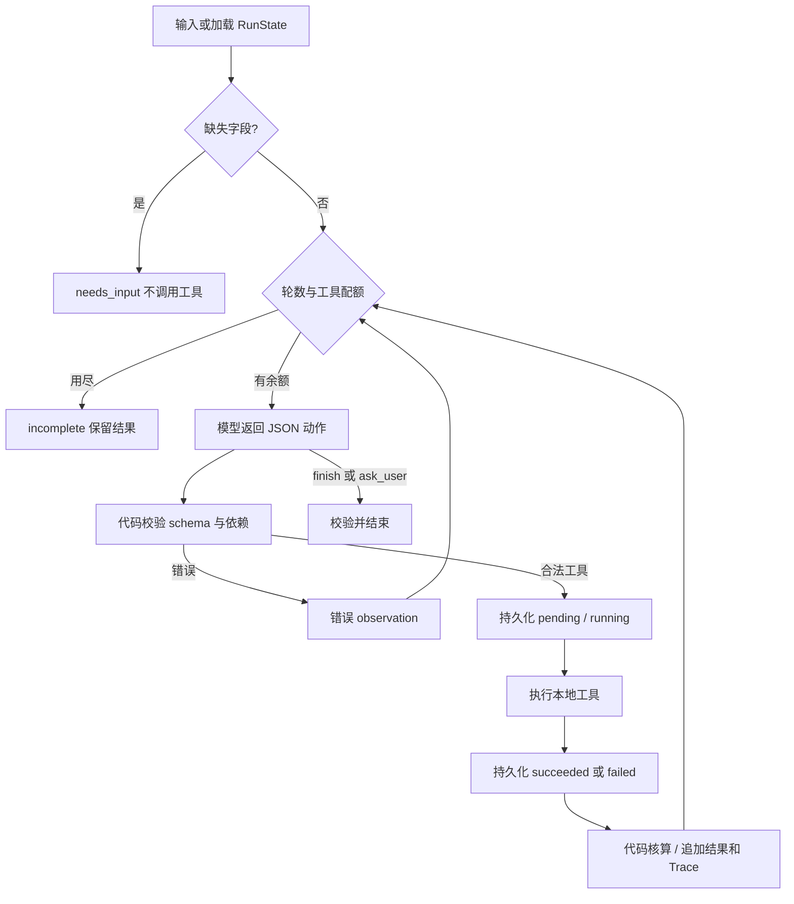

# 02 方案与技术取舍

## 调用流程

这是执行骨架；动作顺序来自 RealLLM.choose 或显式 MockLLM.choose。Agent 中按工具名分派只负责执行，不依据超预算自动切换 variant，不自动重试。Mock 是允许用于离线验收的 observation 驱动脚本策略，不能证明模型推理能力。

## 动态决策点与职责

| 情况 | 模型负责 | 代码负责 |
|---|---|---|
| full 报价超限 | 重生成/改检索/改保存版本，重新估算或结束 | 计算缺口、拒绝超限保存 |
| 工具失败 | 重试、降级或停止 | failed、保存错误和成功历史 |
| 未知工具/非法参数 | 输出修正后的 JSON | schema 校验，错误 observation |
| 依赖缺失 | 补前置步骤或结束 | 校验实际 succeeded 引用 |
| 保存成功 | 选择 finish | 锁定已提交方案，不允许二次提交 |
| 无可行方案 | 选择 no_feasible_plan | 穷举本题 8 种版本组合，校验声明、计算缺口 |

系统 prompt 要求先探索 full 质量基线，以观察实际估算后调整。这是规划偏好；模型仍输出每次动作，执行器未强制初始流程。旧 prompt 下真实模型直接选择 lite 的记录也保留。

## 状态与依赖

RunState.plan 是追加式的步骤尝试列表，包含 id、tool、args、tool_args、dependencies、status、result/error。每次重试创建新步骤，因此旧 failed 不被覆盖。状态集合为 pending/running/succeeded/failed/skipped。

生成引用成功 search_step；估算引用成功 script_step；保存引用成功 estimate_step，并递归检查生成和检索。方案由这些成功结果在代码中组装，模型不能注入自算价格或任意保存内容。

重复请求已成功的同一非保存动作时，执行器追加 skipped 并返回 reused_step，不执行工具。恢复 Trace 单独列出 reused_successful_steps。已成功步骤仍是依赖的权威来源；skipped 本身不冒充成功。

每次转移写临时状态文件、flush/fsync，再 os.replace。Trace events 与状态在同一文件中持久化，导出只是视图，避免两份独立日志不一致。保存文件提交和状态文件不在同一事务内：保存收据的 committed_by 标识 run，若保存后状态未更新，恢复时识别同一收据、恢复原扣费，不重复写文件。不同 run 看到收据只扣 0。

## 核算和保存

内部 quote 是纯核算函数，供候选可行性检查、保存复核和收据核算使用，不触发工具或故障注入；只有模型请求的 estimate_cost 才计为工具调用，测试验证了这一边界。完整组件报价保留在每个成功 estimate 结果中。totals 从 components 求和；模型返回的 rationale 中的任何算术均不作为台账依据。

保存前重新查询 data/tool_costs.json 的已加载配置，验证 plan_hash 和完整报价一致，再比较 total_cost/total_minutes 与约束。价格表在进程初始化时读取；运行中外部改动文件要重启/恢复后加载，因此恢复跨价格变化会拒绝旧估算。

报价与 actual charge 分离：预览不扣费，save 一次性提交各组件费用。保存后拒绝其它工具请求，避免一次 run 多次提交。重复相同请求+内容的路径由稳定 SHA-256 决定；整数 10 与浮点 10.0 规范化后相同。

## 恢复与异常

恢复将上次 running 标为 failed/interrupted_unknown_outcome，把成功结果提供给模型。并不假装知道中断时的执行结果。只有保存存在外部副作用，依靠幂等收据处理未知结果；搜索、生成、估算为无副作用预览。

MAX_STEPS 统计模型选择次数，非法 JSON 和模型网络错误也消耗一轮。工具调用只在依赖与参数校验通过、即将调用时计数；注入失败也计数。达到任一上限统一 reason=max_steps_reached，Trace 标明实际限制来源。finish 也需要一轮；最后一轮刚保存但未 finish 时按要求仍为 incomplete，保留 saved 字段。

真实 API 使用 urllib，无隐式自动重试；超时 60 秒。API 错误直接 incomplete/model_error，可人工恢复。错误日志不打印请求头或 provider reasoning_content。上下文包括已执行状态、观察结果和有限候选报价；当前没有长上下文压缩策略。

## 取舍

没有大型框架，便于审查决策、费用与失败转移。整数模拟费用避免浮点累计误差；预算值只是比较阈值。小规模穷举用于验证 no_feasible_plan，不替模型执行方案。CLI 仅支持模拟分钟，减少绝对时间/时区歧义。

本实现针对单机可信目录；未做并发同一 run 锁、分布式队列、权限系统、数据库事务或真实发布。GitHub CI 是配置，不代表已执行。真实模型的多次成功仅证明这些样本，不能推导泛化成功率。
