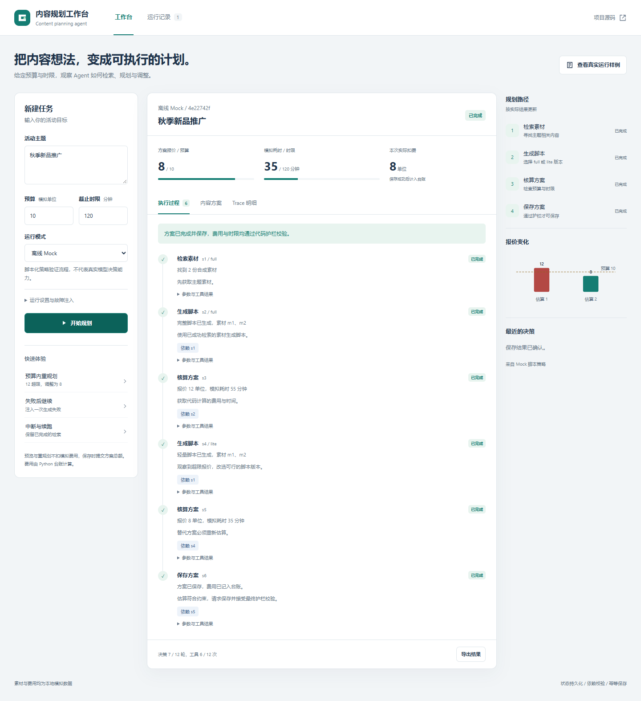

# 前端工作台

## 启动

```powershell
.\.venv\Scripts\python.exe -m src.web
```

或激活虚拟环境后执行 `python -m src.web`，浏览器打开 http://127.0.0.1:8765 。端口可用 `--port 8766` 修改，状态目录可用 `--storage runs/web` 指定。

页面由同一个 Python 进程提供静态文件与 API。前端是原生 HTML/CSS/JavaScript，不需要 Node、npm、构建步骤或新的运行时依赖。浏览器只访问同源 API，不持有 API Key。

## 使用

1. 填写主题、预算和模拟截止分钟数；点击「开始规划」。
2. 默认离线 Mock。真实模式使用服务端的 LLM_BASE_URL、LLM_MODEL、LLM_API_KEY 环境变量；启动前设置，配置方式与 CLI 一致。未配置密钥时禁用真实模式。
3. 「快速体验」只填入参数，点击「开始规划」才真正执行。中断场景将决策上限设为 2，并注入一次脚本生成失败。
4. 「继续执行」为整个 run 增加累计配额，复用已有成功结果，保留失败尝试。单次配额最多 100，达到服务端上限后会明确提示。
5. 「运行记录」读取当前 Web 存储目录中的状态。浏览器刷新不停止后台任务；重启服务后，未完成任务可手动续跑。
6. 「查看真实运行样例」只读展示仓库的 19 组证据，有历史标识，不发起实际模型调用，也不能将历史证据原地续跑。
7. 「内容方案」查看选定脚本；「Trace 明细」查看每轮动作并下载 JSONL；「导出结果」下载完整当前状态。

缺预算/时限不会被页面自动补默认值，服务端返回 needs_input。报价、模拟耗时、实际扣费、失败状态都直接来自 Python RunState；前端不维护另一套账本，不模拟延迟或伪造执行进度。离线运行很快时轮询可能直接拿到完成状态，仍展示完整实际过程。

## 设计

受众是使用 Agent 的运营人员和审阅作业的评审。核心操作是输入任务、运行、检查为何重规划以及保存结果。

以浅灰蓝 #f2f5f7 为底，白色 #ffffff 为工作区域，深蓝 #20344c 为正文，青绿 #147d73 表示操作与完成，红色 #b34844 标识失败及超预算。字体使用系统 Segoe UI / Microsoft YaHei，避免外部字体网络依赖。

桌面采用「任务配置 / 执行工作区 / 规划路径与报价」三列；平板把侧栏放到下方，手机改为单列。强调真实的步骤时间线和 12 → 8 报价变化，不显示虚构运营指标。支持键盘焦点、标签页方向键、弹窗关闭、减少动画偏好；用户内容通过转义或 textContent 渲染。



[手机实际运行截图](images/workbench-mobile.png)

## API 与存储

| 接口 | 用途 |
|---|---|
| GET /api/config | 是否配置真实模型及模型名，不返回密钥 |
| POST /api/runs | 提交任务，202 返回 run_id |
| GET /api/runs | 最近 100 条 Web 任务 |
| GET /api/runs/:id | 当前持久化状态及 active 标记 |
| POST /api/runs/:id/resume | 仅允许增加累计上限，不能改原请求 |
| GET /api/examples | 历史样例索引 |
| GET /api/examples/:name | 只读历史证据 |

默认路径：`runs/web/states/`、`runs/web/saved/`、`runs/web/exports/`。与 CLI 默认的 runs/saved_plans 分开，避免混淆。所有 Web 运行文件均被现有 .gitignore 排除。

后台最多并行两个任务；同一 run 不允许并发续跑。Agent 的原有执行骨架不变，通过 WebAgent 的持久化锁同步 Windows 下读文件与原子替换。API 校验输入和请求体大小；只监听 127.0.0.1，校验 Host 与 Origin，静态文件使用固定白名单，内容安全策略限制同源脚本。

这是本机演示工作台，不是公开多用户服务。没有账号、跨进程锁、反向代理配置或生产级任务队列。不要直接改成对外监听并暴露真实模型密钥的使用能力。部署到公网需要单独设计鉴权与任务隔离。GitHub 仓库存放代码，不自动提供 Python 后端托管。

## 验证

```bash
python -m pytest -q
```

本次完整执行结果：**58 passed**，见 [完整 pytest 输出](../examples/web-pytest-results.txt)。新增 17 个测试覆盖 Web API、后台运行、预算重规划、输入校验、故障恢复、幂等、历史只读、同源拒绝和并发续跑拒绝。

可选浏览器验收：

```bash
python -m pip install -r requirements-browser.txt
# 本机有 Microsoft Edge 时直接使用；其他环境先安装 Chromium：
python -m playwright install chromium
python -m scripts.test_web_ui
```

Playwright 1.64.1 仅用于可选浏览器测试，不是运行依赖。本次使用实际无界面 Edge 完成 11 项交互检查，浏览器 page error 为 0，见 [浏览器结果](../examples/web-ui-results.json)。桌面截图为 1440px 宽，手机截图为 390px 宽，验证无横向溢出。截图来自实际任务状态，不是设计稿。

开发中浏览器检查发现并修复了故障 select 的 HTML 标签错误；接口测试发现并修复了 Windows 轮询读取和状态替换的竞态。保留的报告来自修复后的实际执行。
